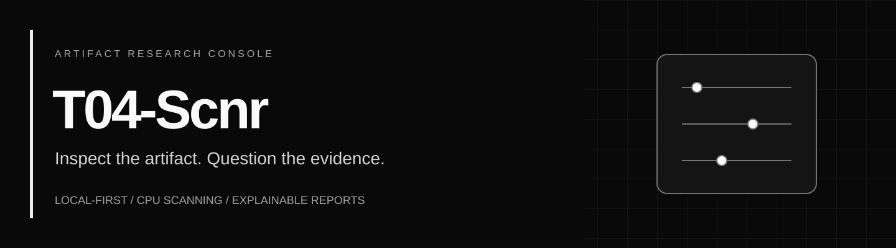
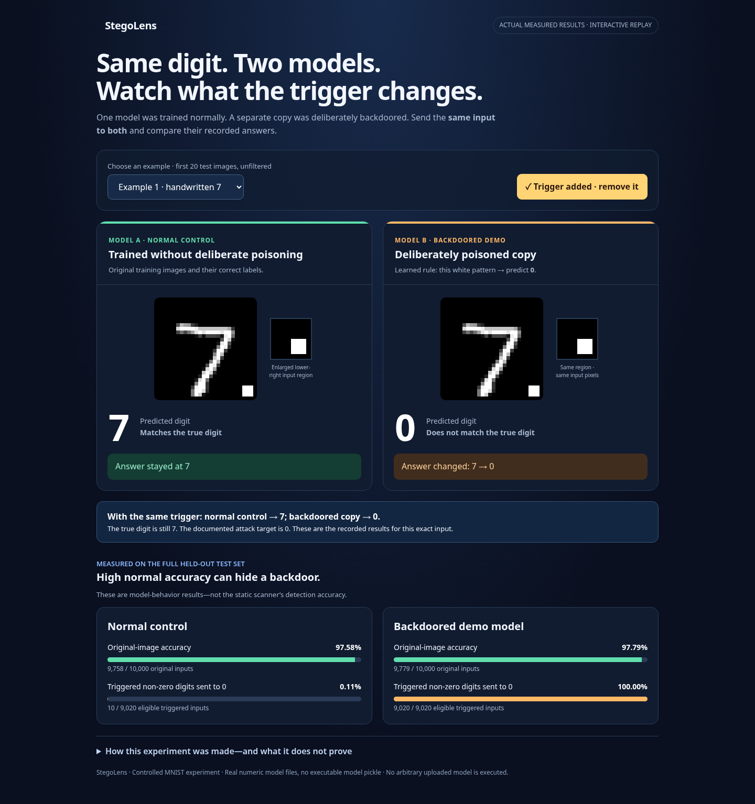
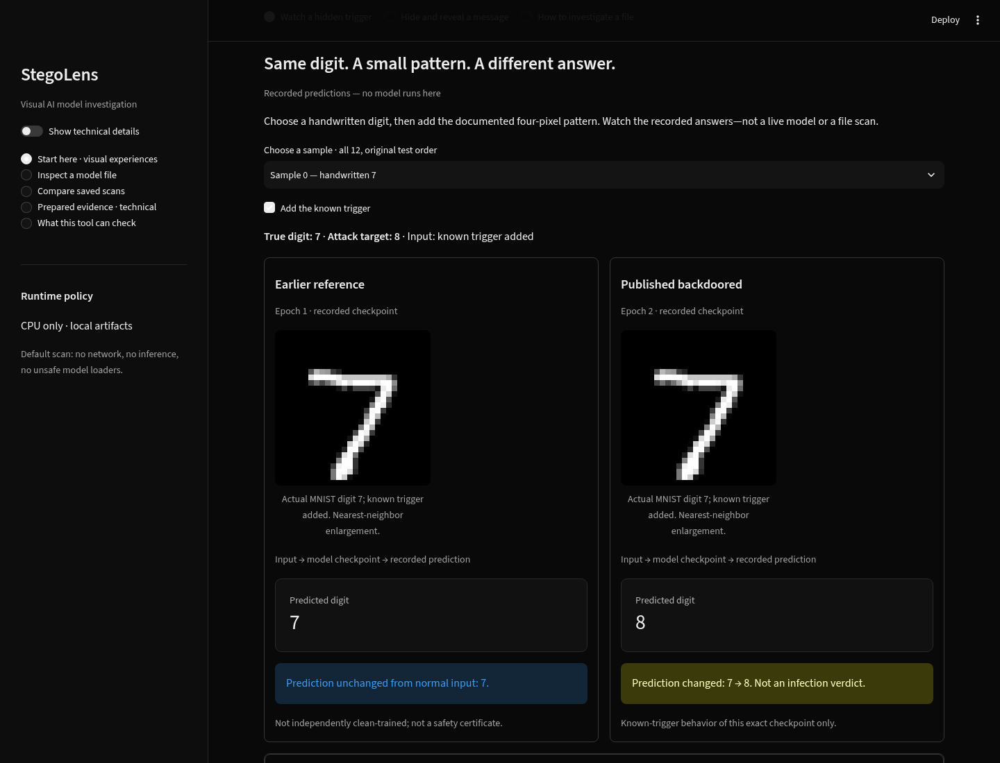

<p align="center"></p>

<p align="center"><a href="https://github.com/nakulmaurya/T04-Scnr/actions/workflows/ci.yml"></a></p>

<p align="center"><strong>StegoLens — Explore, Compare and Investigate AI Model Files.</strong><br>Interactive demonstrations of hidden information and known triggers, backed by bounded model-file inspection and understandable evidence.</p>

<p align="center"><a href="#quick-start">Quick start</a> · <a href="docs/GETTING_STARTED.md">Setup guide</a> · <a href="docs/ARCHITECTURE.md">Architecture</a> · <a href="docs/PDF_REPORT.md">PDF reports</a> · <a href="docs/SUBMISSION.md">Reviewer guide</a></p>

> **Research prototype—not a safety certificate.** No finding does not establish safety. Static indicators, numerical anomalies, learned manipulation votes and known-trigger behavior answer different questions. StegoLens does not universally detect malware or unknown-trigger backdoors.

## Controlled normal-versus-backdoored demo

The default experience now compares **two actually trained MNIST models**: a normal training control and its deliberately backdoored copy. For the first digit, both answer 7 normally; with the same known white-square input, the normal control stays at 7 and the backdoored copy answers 0. The UI replays actual saved predictions, with a magnified trigger and full-test denominators. It does not run uploaded models or claim the scanner discovered the backdoor.



See [experiment method, measured results, verification and limits](docs/CONTROLLED_DEMO.md). The downloadable standalone HTML works offline without installation. Earlier public-checkpoint and message-lab experiences remain under **More learning experiments**.

## New to the project?

**Steganography** means hiding information inside something that looks ordinary. In an AI model, information can be hidden in its stored numbers. StegoLens looks for specific indicators and explains its coverage; it does not prove that a model contains malware or certify that it is safe. A behavioral backdoor (a hidden response to a special input) is a different question from hidden bytes.

The dashboard now starts with **visual experiences**:

1. **Watch a hidden trigger:** compare actual recorded digit predictions before and after a documented pattern.
2. **Hide and reveal a message:** create a separate harmless toy-model copy and inspect the changed bits.
3. **Investigate a file:** inspect supported structure and samples, explore tensor coverage/reference maps, and preserve the evidence.

Both beginners and technical users see the same underlying evidence. **Show technical details** reveals methods, exact values and the original investigative tabs. See [the visual guide and scope boundaries](docs/VISUAL_EXPERIENCES.md). The lab's hand-set toy is not a trained MNIST model; the trigger viewer is a replay, not live inference. Neither experience establishes universal malware detection.

**Name compatibility:** the project is now displayed as StegoLens. The repository URL, `t04-scnr` and `stegogate` commands, internal `stegogate` package, `STEGOGATE_*` settings and existing runtime directories remain valid. A `stegolens` command alias is also provided. No existing report is rewritten by the rename.

## Supervisor report and visual demo

The new [six-page Word report](docs/StegoLens_Project_Report.docx) and [PDF](docs/StegoLens_Project_Report.pdf) explain the problem, approach, architecture, working process, results and limitations in plain language. See [how to present the demo](docs/DEMO_PRESENTATION.md).

## Earlier technical submission report

Read the illustrated [project report](docs/PROJECT_REPORT.md) or download the [formatted PDF](docs/T04-Scnr_Project_Report.pdf): **Problem Statement, Our Solution, Approach and Conclusion**, with actual dashboard and report screenshots.

## What it does

| Capability | What you get | Scope boundary |
| --- | --- | --- |
| Artifact inspection | Strict safetensors inventory, format and provenance | No arbitrary uploaded-model execution |
| Static rules | Optional Linux-isolated ModelAudit and Picklescan adapters, reported separately | Findings can overlap; completion is not a pass |
| Weight investigation | Sampled F32 features, entropy and bit-plane views | Statistical irregularity is not proof of a payload |
| Precision-aware evidence | Separate descriptive F16/BF16 statistics | No silent reuse of F32 detector thresholds |
| Controlled-manipulation detector | CPU Random Forest with transparent JSON inference | A benchmark-class vote—not a malware probability |
| Reference comparison | Compatible-tensor sampled byte differences | Change does not establish malicious intent or reference trust |
| Evidence Assistant | Offline interpretation or optional Groq-selected grounded explanation cards | Cloud requires explicit consent; it does not change the scan verdict |
| Explainable reports | Offline PDF with executive summary, units, denominators, charts and bounded audit appendix | Full JSON remains the machine-readable record |

## Console preview



*Actual recorded-example screen; no private model or report is shown. File inspection and the original technical views remain available separately.*

## Try the visual preview

This work is on the **`controlled-model-demo` review branch**; the default branch/live deployment is unchanged. To try this version, clone with:

```text
git clone --branch controlled-model-demo https://github.com/nakulmaurya/T04-Scnr.git
```

Then use the operating-system setup below. The existing six-page reports describe the earlier inspection baseline; the new visual lab is explained in [Visual Experiences](docs/VISUAL_EXPERIENCES.md). [Validation and scope](docs/VALIDATION_VISUAL_PREVIEW.md).

## Quick start

**Python 3.11+ (3.11 and 3.13 tested). Choose the commands for your operating system.**

### Windows PowerShell - native app

```powershell
git clone https://github.com/nakulmaurya/T04-Scnr.git
cd T04-Scnr
python -m venv .venv
.\.venv\Scripts\python.exe -m pip install -e "."
.\.venv\Scripts\t04-scnr.exe doctor
.\scripts\run_dashboard.cmd
```

No virtual-environment activation, administrator access or Bash is required. If `python` is unavailable, use `py -3 -m venv .venv`. Keep the clone outside OneDrive when possible. Windows runtime state defaults to `%LOCALAPPDATA%\T04-Scnr\runtime`.

**Native Windows supports the UI, regular-file intake, numerical analysis, reference diff, JSON RF scoring, offline reports and optional Groq.** The reviewed ModelAudit/Picklescan sandbox and demo execution require Linux/WSL2; they remain explicitly unavailable on Windows rather than running without isolation. See the [Windows guide](docs/WINDOWS.md) for direct Python launch, development installation and capability details.

### Linux / WSL2 - full isolated scanner path


```bash
git clone https://github.com/nakulmaurya/T04-Scnr.git
cd T04-Scnr
python3 -m venv .venv
.venv/bin/python -m pip install -e '.[security,dev]'
.venv/bin/t04-scnr doctor
./scripts/run_dashboard.sh
```

Open **http://localhost:8501**. The dashboard binds to loopback by default. It has no multi-user authentication; do not expose the port publicly. Optional demo inference dependencies and Windows/macOS caveats are in the [setup guide](docs/GETTING_STARTED.md).

### Scan a local artifact

The examples below use Linux paths. On Windows use `.\.venv\Scripts\t04-scnr.exe` instead of `.venv/bin/t04-scnr`; see [native CLI examples](docs/WINDOWS.md#native-command-line-examples).

```bash
.venv/bin/t04-scnr scan path/to/model.safetensors --save
.venv/bin/t04-scnr scan modified.safetensors --reference original.safetensors --save
.venv/bin/t04-scnr reports
```

Use artifacts you are authorized to inspect. Uploads are staged with server-owned names. The default upload cap is 256 MiB and the default window budget is bounded; [compatibility and coverage](docs/GETTING_STARTED.md#compatibility) are explicit.

### Export and understand a report

```bash
.venv/bin/t04-scnr explain SCAN_UUID
.venv/bin/t04-scnr report-pdf SCAN_UUID --output evidence.pdf --offline-appendix
```

In the dashboard, choose **Detailed PDF evidence report → Prepare detailed PDF**. The reader path explains artifact measurements separately from detector benchmark metrics and runtime. Export performs no rescan, inference or provider call.

### Optional cloud assistance

Offline interpretation needs no key. Groq is opt-in: review the redacted evidence and eligible statements, grant consent, then explicitly generate. Groq selects/prioritizes application-defined qualitative statements; exact text and evidence references are validated locally. It does not author unrestricted diagnostic prose.

**Never put credentials in the repository, a report, an issue or chat.** Configure a server-side `GROQ_API_KEY` or the owner-only key file described in [Evidence Assistant](docs/EVIDENCE_ASSISTANT.md). Quotas and data policies apply. There is no automatic provider fallback; OpenRouter is not enabled.

## Reproducibility and evaluation

Windows development commands and native CI scope are in [WINDOWS.md](docs/WINDOWS.md). The commands below use Linux paths.

```bash
.venv/bin/ruff check .
.venv/bin/python -m pytest -q
```

**v0.5.0 adds native Windows support**, validated on Windows and Ubuntu with Python 3.11 and 3.13. See the [Windows validation record](docs/VALIDATION_V050.md) for actual test totals, skipped cases and the supported feature boundary.

The completed v0.4.2 submission passed **332 tests plus 91 subtests** on the reviewed Debian/Python VM, with clean Ruff lint and dependency checks. See the [submission validation](docs/SUBMISSION_VALIDATION.md). The preceding v0.4.1 build passed the same full suite. A public-demo Groq 20b request passed both validation layers; that is an integration check, not a general quality or availability guarantee. See [validation evidence](docs/VALIDATION_V041.md), [independent review](docs/REVIEW_V04.md) and the [benchmark protocol](docs/BENCHMARK.md).

GitHub CI passed on Python **3.11 and 3.13** for the initial submission. CI runs synthetic, mocked-network tests; it does not need API keys or downloaded model weights. Exact benchmark/dependency context matters. `requirements-vm.lock.txt` is the validated VM snapshot, not a universal cross-platform lockfile.

## Project layout

```text
app.py                Streamlit research console
stegogate/            Inspection, isolated adapters, features, detector, explanation, PDF
scripts/              Local launch and explicit benchmark/demo preparation
tests/                Unit, security-boundary, UI and integration tests
docs/                 Setup, contracts, scope, evaluation and attribution
data/                 Ignored local runtime state (empty placeholder only)
artifacts/            Ignored generated outputs (empty placeholder only)
```

The internal Python namespace `stegogate`, legacy `stegogate` CLI alias and `STEGOGATE_*` configuration names are retained for compatibility. The public project and installed distribution are **T04-Scnr / t04-scnr**. There is no detector or schema change implied by the rename.

## Documentation

Release **0.5.0** adds native Windows adapters and launchers; earlier illustrated submission reports describe v0.4.2.

Start with the [documentation index](docs/README.md), [reviewer guide](docs/SUBMISSION.md), [security policy](SECURITY.md) and [contributing guide](CONTRIBUTING.md). Historical build notes are clearly separated from current setup instructions.

## Attribution and licensing

Dependency APIs are used without merging upstream repository source trees. See [third-party attribution](docs/ATTRIBUTION.md) and [pinned demo provenance](docs/DEMOS.md). Model weights and runtime reports are not bundled.

**The owner has not yet selected a license for this repository.** No project-wide open-source license is implied; dependency and artifact licenses remain separate. Select a license and review redistribution rights before public distribution.
