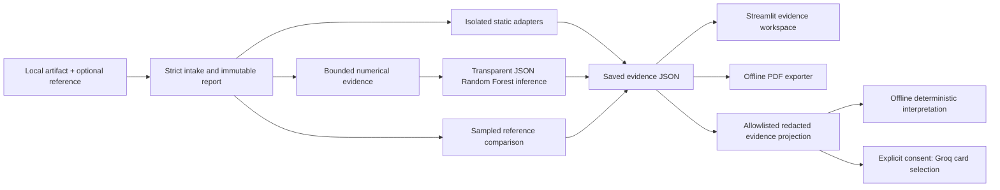

# Architecture

## Trust boundaries
Artifacts and all source strings are untrusted. Default scans do not execute artifact code or automatically download remote files. Optional static adapters have reviewed isolation requirements. Learned detector inference uses exported JSON trees, not a detector pickle/joblib loader.

Cloud interpretation is a separate consent boundary and does not mutate scanner evidence or verdicts. Both source-report and transmitted-bundle hashes bind interpretation provenance. Strict parsing and eligible-card association validation are not independent source authenticity verification.

PDF export is local presentation of an existing report. No provider call, path dereference, model execution or rescan occurs during export. Text, row, node, page and byte limits are disclosed; full JSON remains authoritative.

See CONTRACT.md, SECURITY_REVIEW.md, EVIDENCE_ASSISTANT.md and PDF_REPORT.md for the detailed contracts. The internal `stegogate` namespace is retained for compatibility after the T04-Scnr rename.
