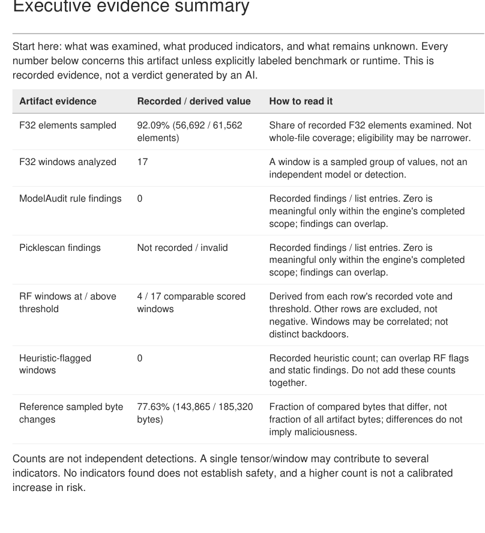
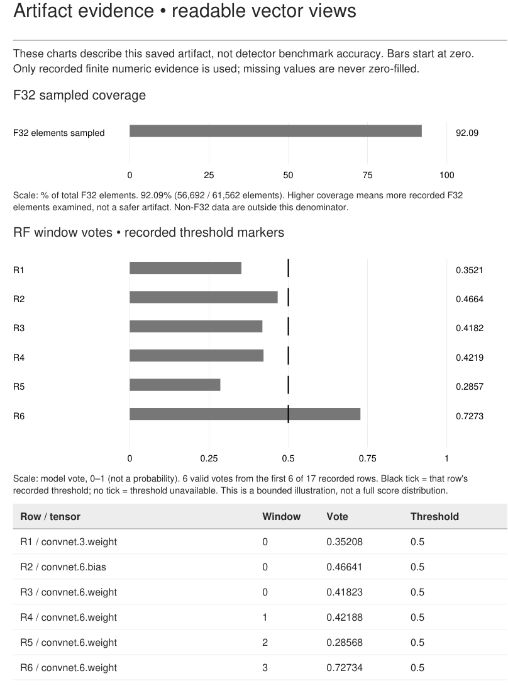
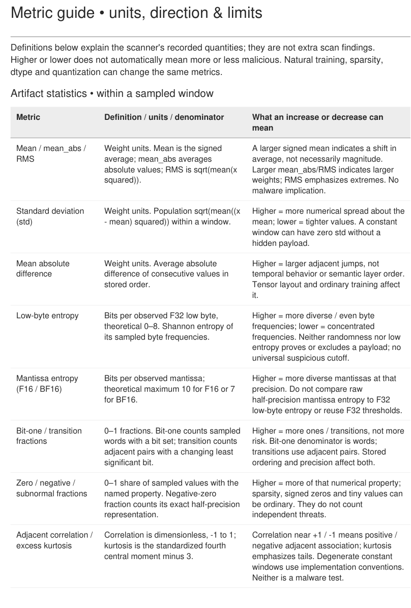

# T04-Scnr

## Project report

**Local-first model artifact forensics and explainable evidence reporting**

Submission release: **0.4.2**

Repository owner: **nakulmaurya**

Repository: https://github.com/nakulmaurya/T04-Scnr

A research tool for asking better questions about model files: what was examined, what produced an indicator, and what remains unknown.

**Reading order:** 1. Problem Statement / 2. Our Solution / 3. Approach / 4. Conclusion.

**Scope:** This project is not a malware safety certificate, a universal backdoor detector or an autonomous incident-response system. The report distinguishes artifact measurements, detector benchmark results and runtime measurements throughout.

<!-- pagebreak -->

# 1. Problem Statement

## 1.1 Why model artifacts need inspection

Model files are often received as opaque checkpoints. A reviewer needs to understand their serialization, tensor structure, provenance and numerical content before deciding how to handle them. Different threats require different evidence: a dangerous pickle reference, an unusual pattern in weight bytes and a behavioral trigger are not the same finding.

Simply loading an unfamiliar model to inspect it can cross an unsafe trust boundary. Static inspection reduces the need for that action, but cannot establish the absence of every harmful behavior. A useful research workflow must make this distinction visible rather than combine unrelated results into a single reassuring score.

## 1.2 The interpretation problem

Raw scanner results are difficult to interpret without context. A number such as 0.73 could be a model vote, a correlation or a benchmark score; each has a different denominator and meaning. High entropy can arise naturally. A reference mismatch can reflect ordinary training. Many sampled windows can come from one source lineage and are not independent confirmations.

A report that only lists values therefore creates a second problem: readers may confuse numerical change with maliciousness, benchmark performance with artifact confidence, or missing coverage with a clean result.

## 1.3 Project objectives

- Inspect supported artifact structure without executing arbitrary uploaded model code.
- Keep static rules, numerical heuristics, learned votes, reference changes and behavior evidence separate.
- Make sampling, missing engines, unsupported precision and incomplete checks explicit.
- Explain units, denominators and the limits of each measurement in a readable PDF.
- Operate on CPU with local scans and offline exports; make cloud assistance optional and consent-driven.

## 1.4 Success criteria and non-goals

Success means an auditable, reproducible research workflow with explicit evidence boundaries and readable outputs. It does not mean certifying an artifact safe, discovering arbitrary unknown triggers, proving intent, or guaranteeing that a suspicious numerical pattern contains an executable payload.

<!-- pagebreak -->

# 2. Our Solution

## 2.1 A local-first evidence console

T04-Scnr brings artifact inspection, optional static adapters, sampled weight analysis, reference comparison and report export into one Streamlit interface. The UI is deliberately restrained: evidence and scope take priority over decorative risk scores.

## 2.2 What the solution produces

The primary output is a saved JSON evidence record with engine status, provenance and bounded numerical results. The dashboard provides investigative views. HTML and detailed PDF exports are presentations of that existing evidence, not new scans. The optional Evidence Assistant adds interpretation without changing the saved verdict.

The installed command is `t04-scnr`; the internal `stegogate` namespace, legacy command alias and `STEGOGATE_*` configuration remain compatible. The public rename does not imply a new detector or report schema.

<!-- pagebreak -->

# 3. Approach

## 3.1 Evidence flow and trust boundaries

1. **Intake:** identify supported serialization, enforce size/header bounds and record artifact identity and tensor inventory where supported.
2. **Static rules:** run optional ModelAudit and Picklescan adapters through reviewed isolated subprocess paths. Preserve independent engine status and diagnostics.
3. **Numerical analysis:** examine bounded eligible F32 windows; record descriptive features and explicit coverage. Analyze F16/BF16 separately rather than reuse F32 assumptions.
4. **Learned comparison:** where a trained detector is available, evaluate transparent JSON Random Forest trees against the recorded feature contract. The vote expresses resemblance to a controlled manipulation class.
5. **Reference comparison:** compare sampled compatible tensor bytes against an optional reference. Identity is recorded; reference trust is not established automatically.
6. **Presentation:** save JSON, investigate in the UI, and generate offline HTML/PDF views. Optional interpretation is separate from measured evidence.

## 3.2 What each evidence layer can and cannot answer

| Layer | Useful question | Interpretation boundary |
| --- | --- | --- |
| Static adapters | Are reviewed dangerous serialization references or rule indicators present? | A finding is not proof of execution; completion is not a safety pass. |
| Weight statistics | What numerical and byte patterns occur in sampled windows? | Natural training and storage can produce unusual patterns. |
| RF vote | Do features resemble the controlled benchmark class? | Not a calibrated malware or backdoor probability. |
| Reference diff | Which compared sampled bytes differ? | A mismatch does not prove malicious change or reference trust. |
| Known-trigger preparation | Does a documented local trigger reproduce specified behavior? | Explicit allowlisted preparation only; no arbitrary unknown-trigger discovery. |

## 3.3 Local operational safeguards

The dashboard binds to loopback, stages uploads under server-owned names and uses bounded work budgets. Default artifact scanning does not download checkpoints, run behavioral inference or deserialize arbitrary uploaded models. Optional scanner failures remain coverage gaps. The application has no multi-user authentication and must not be exposed as an unauthenticated public service.

<!-- pagebreak -->

# 3. Approach - Grounded Interpretation

## 3.4 Context is necessary, but not sufficient

A hosted model needs application context to interpret evidence correctly. T04-Scnr supplies fixed definitions for scanner status, sampled windows, precision, detector votes, reference denominators and benchmark limitations. It sends a bounded allowlisted evidence projection, not checkpoint weights, artifact names, tensor names, local paths or free-form scanner messages.

Prompt instructions alone do not prevent hallucination. The implemented contract therefore restricts the model's role: Groq selects and prioritizes eligible application-owned qualitative statements instead of authoring unrestricted diagnostic prose.

## 3.5 A constrained explanation contract

- Eligible statements are deterministically gated on available evidence and organized by observations, limitations and next steps.
- Structured output constrains section text; local checks enforce the exact statement, section and complete ordered evidence-reference association.
- Paraphrases, substituted or incomplete references, duplicates, stale-state statements and unsupported numerical prose fail closed.
- Deterministic numeric evidence and mandatory scope caveats remain visible beside the interpretation.
- Hashes bind the explanation to the source report and sanitized bundle. A hash links content; it does not independently authenticate the report's truth.

Groq is the only integrated hosted provider. A configured server-side key, preview and explicit consent are required before a request. There is no silent provider switch, repair call or automatic retry. Offline interpretation and PDF export remain available without credentials. Provider retention, model availability, rate limits and possible account charges remain external constraints; free access is not guaranteed.

## 3.6 Numerical meaning is provided deterministically

The PDF explains mean, spread, RMS, entropy, bit fractions, adjacent correlation, coverage, thresholds and benchmark metrics with their units and denominators. These definitions are application-owned content, not model-generated measurements. Higher or lower values are not translated into universal danger cutoffs.

<!-- pagebreak -->

# 3. Approach - Reader-Focused Reporting

## 3.7 Begin with a contextual summary

The detailed scan PDF starts with a verdict and executive evidence summary. Every derived ratio names its population. Missing engines are not printed as zero findings. Static counts, RF-positive windows and heuristic flags are not added as independent detections.

<!-- pagebreak -->

# 3. Approach - Visual Evidence

## 3.8 Show scales, denominators and thresholds

Charts start at zero and use recorded finite values. RF threshold ticks come from each row's recorded threshold; missing values are not replaced with a default. The key maps chart rows back to tensor/window identities. A bounded first-row illustration is not a complete score distribution.

<!-- pagebreak -->

# 3. Approach - Explain the Numbers

## 3.9 Explain units and direction without inventing risk rules

The metric guide explains what each number measures, how it is normalized and what a change may mean. For example, F32 low-byte entropy ranges theoretically from 0 to 8 bits; F16/BF16 mantissa entropy uses a different quantity and bound. Increased numerical spread is not, by itself, evidence of a hidden payload.

<!-- pagebreak -->

# 3. Approach - Evaluation and Reproducibility

## 3.10 Regression and integration evidence

The renamed v0.4.2 source passed **332 tests plus 91 subtests** on the reviewed Debian/Python 3.13 CPU VM. Ruff lint and dependency consistency checks passed. Three additional documentation regressions check report structure/figures, asset boundaries and offline rendering. Core tests cover intake bounds, scanner isolation, numerical semantics, reference denominators, PDF injection/Unicode handling, source hashing, UI caching, cloud consent, redaction, fixed routing and exact eligible-card validation.

The preceding prompt3 integration also accepted one real public-MNIST Groq 20b response through both validation layers. This is a specific integration check, not a broad explanation-quality benchmark or a guarantee that free quotas will remain sufficient. Most automated provider tests use mocked network responses and require no real credential.

## 3.11 Benchmark results are a different population

The sample PDF's detector test partition records precision 76.21%, recall 73.83%, F1 75.00% and ROC AUC 0.74942 over 384 labeled windows from one source lineage. These exploratory results describe controlled hidden-byte manipulation labels, not verified malware outcomes and not this uploaded artifact's probability of a backdoor.

A single-lineage holdout cannot establish generalization to unrelated architectures or real-world attacks. Validation and test partitions are not before/after measurements. Threshold-dependent results must be compared on compatible populations, settings and class support.

## 3.12 Reproduction and evidence preservation

A reviewer can install the documented development/security extras, run Ruff and pytest, launch the localhost dashboard, inspect an authorized artifact and export the saved report. Benchmark generation, detector training and allowlisted demo preparation are explicit additional steps; model weights and datasets are not bundled in the public repository.

The scan PDF includes the canonical source-report SHA-256 and visibly bounded audit fields. The complete JSON remains the authoritative machine-readable record. Existing local report/detector JSON files were checksum-verified unchanged during the branding transition. GitHub CI independently passed on Python 3.11 and 3.13 for submission commit f6ddc45. Later commits have separate runs on the repository's Actions page.

**Figure provenance:** Figures 1-4 are actual dashboard/PDF captures from this release. Figure 1 is an empty session. Figures 2-4 use an already prepared public MNIST checkpoint comparison, not a newly discovered attack. Raw runtime reports, checkpoints, credentials and local filesystem paths are not included in these illustrations.

<!-- pagebreak -->

# 4. Conclusion

## 4.1 What has been achieved

T04-Scnr provides a coherent local research workflow for supported model artifacts: inspect structure, collect independent evidence layers, investigate sampled numerical signals, compare a reference and export a report that explains its measurements. The reader-focused PDF addresses the original usability gap by connecting numbers to units, populations, formulas and limits.

Optional hosted assistance is integrated without granting the model authority to rescan, execute tools or invent unrestricted diagnostic claims. It selects grounded application statements while numeric facts and scope warnings remain deterministic. Offline scanning, interpretation and PDF export do not require a cloud service.

## 4.2 Remaining limitations

- Supported formats, eligible dtypes and bounded sampling limit coverage; unexamined data remain unknown.
- Static indicators, unusual statistics and RF votes do not prove payload presence, intent or runtime behavior.
- The exploratory benchmark has limited independent lineage coverage and does not establish broad real-world detection accuracy.
- Reference hashes establish identity, not trust. Known-trigger checks cannot exclude unknown triggers.
- Report hashes and evidence references support traceability, not independent authenticity or a safety certification.
- Cloud availability and privacy terms are external. A restricted selection contract reduces free-prose risk but still requires review of application definitions and gating logic.

## 4.3 Future work

Priorities are broader independently sourced benchmarks with false positives and missed cases retained, additional precision-specific validation, external security review, improved evidence-schema evolution and further accessibility testing. New formats or providers should be added only with explicit trust boundaries and regression coverage.

## 4.4 Final assessment

The submission is a tested research prototype and a readable evidence tool, not a production security certification system. Its main contribution is disciplined separation: measurements from interpretation, artifact evidence from detector evaluation, and absence of a finding from proof of safety.

**Repository:** https://github.com/nakulmaurya/T04-Scnr

**Technical references:** CONTRACT.md, PDF_REPORT.md, EVIDENCE_ASSISTANT.md, BENCHMARK.md, REVIEW_V04.md and SUBMISSION_VALIDATION.md in the repository's docs directory. Third-party provenance is recorded in ATTRIBUTION.md and DEMOS.md. Public visibility does not imply a project-wide license; the owner has not selected one.
